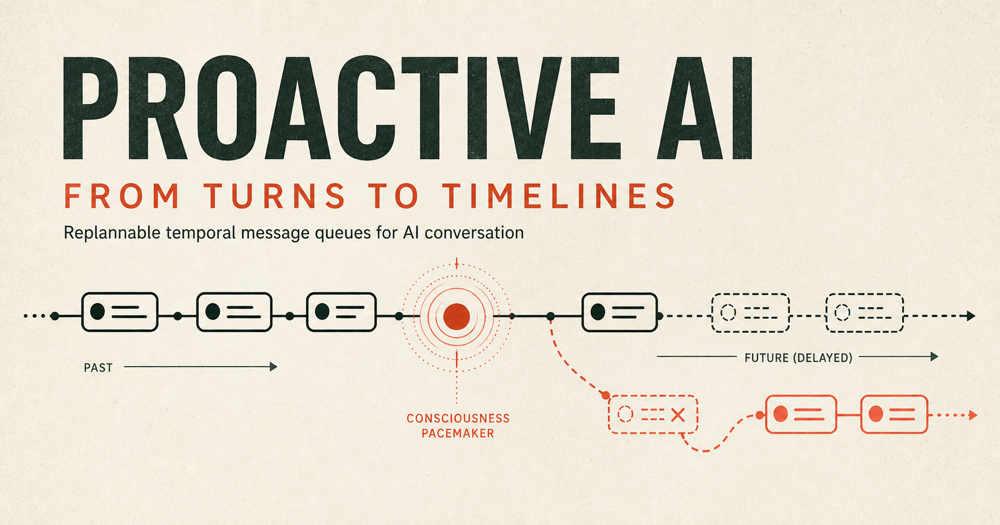

# Proactive AI

[English](README.md) | [中文](README.zh.md)

> 即使用户停止输入，AI 也不会停止存在。

Proactive AI 是一个关于异步、持续和主动式 AI 对话的开源探索项目。



大多数 AI Chat 都遵循严格的请求—响应模式：用户发送一条消息，AI 返回一次回答，随后重新等待。人与人之间的交流并不是这样。人们可能连续发送多条消息、隔很久才回复、看见消息但不回复、重新提起之前的话题，或者在没有收到新消息时主动开始聊天。

Proactive AI 希望探索另一种模式：对话是一条持续发展的时间线，而用户的每条消息都是 AI 可以观察的事件，并不是一项必须立即回答的请求。

## 核心想法

### 1. 回复时间队列

AI 可以生成零条、一条或多条消息。消息既可以立即发送，也可以进入一个可变的时间队列，等待以后发送。

进入队列的内容并不是不可改变的承诺。在真正发送之前，如果对话发生变化，AI 可以保留、修改、推迟或取消这些内容。

队列支持两种未来行动：

- `send_message`：到达最早允许发送的时间后，发送已经准备好的内容。
- `reconsider`：在未来某个时间重新醒来，届时再决定是否需要说话。

### 2. 对话起搏器

即使用户没有继续发送消息，周期性的对话起搏器也可以唤醒 AI，使其重新检查最近的对话、长期记忆、尚未执行的队列项目以及时间的流逝。

醒来不等于必须说话。AI 可以继续保持沉默、增加一项未来行动、重新安排已有计划，或者主动开始一段对话。

### 3. 有界沉默

可选的联系截止时间可以避免每次起搏都以沉默结束。截止时间之前，AI 仍可保持沉默；到期后，如果外部策略允许主动联系，运行时要求下一份合法计划产生至少一条可见消息。用户可以随时暂停或关闭这一行为。

### 4. 事件驱动的重新排程

以下三种事件都可以触发 AI 重新考虑当前计划：

1. 用户发送了新的消息；
2. 对话起搏器到期；
3. 队列中的项目到达计划时间。

每次触发后，AI 都可以先根据最新对话重新整理待执行队列，再决定是否采取行动。

用户的每次发送都会被记录为独立到达事件。消息到达会请求系统作出新的判断，但不意味着必须对应一次模型调用或一条可见回复。短时间内相邻到达的消息可以共享一次决策快照；如果模型推理期间又收到新消息，旧快照产生的候选计划会在提交前失效。

## 项目目标

Proactive AI 第一阶段希望回答这个问题：

> 如果 AI 可以自主决定何时观察、何时沉默、何时回复、何时重新思考以及何时主动开始对话，人机交流能否比传统的回合制聊天更加自然和连续？

项目追求的是人类交流中的时间感、节奏感、连续性和主动性，而不是让 AI 冒充真人。用户应当始终知道对方是 AI，并能够查看、限制或关闭它的主动行为。

## 可运行原型

仓库目前已经包含可执行的 TypeScript 协议、确定性时间线引擎、OpenAI-compatible 模型适配器、中英双语交互 Demo、自动测试，以及使用 ACM LaTeX 模板撰写的研究论文。

想知道这些能力如何实现，先读[实现原理](docs/zh/implementation.md)：从一份完整 JSON 计划开始，解释模型判断、时间队列、对话起搏、发送前复核与代码之间的关系。

阅读论文 LaTeX 源文件：[中文版](paper/main_zh.tex)或[英文版](paper/main.tex)。如需生成本地 PDF，请参阅[论文编译说明](paper/README.zh.md)。

需要 Node.js 22.13 或更高版本，以及 pnpm 11.20.0。仓库中的 `packageManager` 字段可供 Corepack 选择预期的 pnpm 版本。

```bash
pnpm install
pnpm dev
```

打开 `http://localhost:3000`。“场景演示”通过实际引擎播放预设故事，无需 API Key。连接 Qwen、OpenAI 或 LiteLLM 网关时，把 `apps/demo/.env.example` 复制为 `apps/demo/.env.local`，并参考[模型提供商指南](docs/zh/model-providers.md)。

Timeline Lab 分为“场景演示”（播放、暂停、单步、重播）和“真实对话”（使用已配置模型自由输入）。真实对话默认跟随电脑时钟，模拟时间收在高级控制中，两种体验的状态彼此隔离。发送首条消息后，真实对话处于活动状态时会自动处理到期事件，即使没有新输入也可能产生 API 费用。存储与调度边界见 [Demo 指南](docs/zh/demo.md)。

配置模型后，使用 `pnpm model:smoke` 验证一次真实接口调用。

## 仓库结构

```text
apps/demo       交互式 Timeline Lab
packages/core   协议、引擎、规划器和模型适配器
docs/en         英文文档
docs/zh         简体中文文档
paper           ACM LaTeX 论文
```

运行全部验证：

```bash
pnpm test
pnpm lint
pnpm build
```

进一步了解当前行为模型，请阅读[中文文档](docs/zh/README.md)、[核心概念](docs/zh/core-concepts.md)，以及精确定义可执行契约的[时间对话协议](docs/zh/protocol.md)。

## 许可证

本项目编写的软件代码和开发文档采用 [Apache-2.0](LICENSE) 许可证，署名信息见 [NOTICE](NOTICE)。论文正文及论文专用插图不包含在此软件许可范围内，具体见[论文授权说明](paper/LICENSE.md)。第三方文件保留各自原有的许可证。
